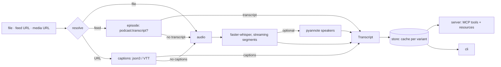

# Architecture

> How a source becomes a cached, paged, cite-ready transcript.

## Overview



## How it runs

On Linux and macOS each `quotable serve` is a stdlib-only shim (~12 MB) that relays
stdio to one shared process per user; that process owns the model and the GPU.
`QUOTABLE_DAEMON=off`, and Windows, serve in-process instead.

```text
session ─stdio─► shim ─┐
session ─stdio─► shim ─┼─► $XDG_RUNTIME_DIR/quotable/<key>.sock   (dir 0700)
session ─stdio─► shim ─┘          │ spawned on first connect; holds <key>.sock.lock for life
                                  ▼
          shared process: one MCP session per connection, one model,
          one GPU queue; idle or outdated → {"quotable_bye": N} to every shim, then exits
```

- **Key.** First 16 hex of a hash of the version, package dir, newest `quotable/*.py`
  mtime, `sys.prefix`, each installed `*.dist-info` with its mtime, and the
  `QUOTABLE_*` settings (minus `QUOTABLE_DAEMON`), `HF_TOKEN`, `XDG_DATA_HOME`.
  Different code, dependencies or settings never share a process; whenever
  nothing is in flight, the process rechecks its key (every second) and leaves
  once it is no longer current.
- **Lifetime lock.** A process takes `flock` on `<key>.sock.lock` non-blocking and
  holds it until exit; only the holder binds or unlinks the socket, so ten shims
  starting at once make one process.
- **Hello.** A connection's first line is `{"cwd": …}`; relative local sources
  resolve against it (`daemon.SESSION_CWD`), and the process itself runs in `/`.
- **Idle exit.** After `QUOTABLE_MODEL_TTL` with nothing in flight on any
  connection and the inference lock free (`0` = never). Session-long requests
  (`daemon.STREAMS`: Claude Code's `subscriptions/listen`) do not count as in flight.
- **Bye vs crash.** A planned exit sends each shim the count of lines it read; the
  shim respawns and resends only the later lines, which provably never ran. A crash
  (no bye) fails each in-flight call with a JSON-RPC error; nothing is retried.
- Logs: `~/.local/state/quotable/daemon.log`.

## Modules

All under `src/quotable/`. Arrows point from caller to callee; nothing below
`pipeline` imports anything above it.

| Module | Role | Depends on |
|--------|------|------------|
| `models` | Pydantic models (`Transcript`, `Segment`, `Word`, `Chapter`, `MediaInfo`, `TranscriptPage`) and the `QuotableError` family, each with a `fix` | - |
| `config` | `Settings.from_env()`: `QUOTABLE_*` variables, device auto-detect, per-device defaults | - |
| `captions` | Pick a caption track (json3 first, VTT with rolling dedupe second), parse it, read chapters | `models` |
| `audio` | Local file passthrough, yt-dlp `bestaudio` download, source keys and `cite_url` per kind | `models` |
| `feeds` | Sniff a feed, pick an episode, use `<podcast:transcript>`, else the enclosure; http(s) only, redirects checked | `models` |
| `transcribe` | One warm `WhisperModel` per process, CUDA with CPU fallback, segment iterator with `clip_timestamps` resume, inference lock | `config`, `models` |
| `diarize` | Optional pyannote pipeline; speakers assigned to words by overlap, to segments by majority | `transcribe`, `models` |
| `store` | Atomic per-variant cache, `partial.jsonl` for resume, id validation, paging by offset or time window, txt/srt/timestamped renderers | `models` |
| `pipeline` | Orchestration: resolve, captions first, Whisper fallback, locks, cancel, `Outcome(transcript, path, cached)` | everything above |
| `server` | `MCPServer`: three tools, two resources, progress and cancel bridge to the pipeline thread | `pipeline`, `store` |
| `shim` | Socket key, private runtime dir, connect-or-spawn, line pump, `initialize` replay, resend after a bye. Stdlib only | - |
| `daemon` | Shared process: lifetime lock, `detach` (fd 0 → `/dev/null`, fd 1/2 → log), one SDK session per connection, in-flight tracking, bye and exit | `server`, `shim`, `transcribe` |
| `cli` | `quotable get | info | serve` (+ hidden `daemon`); `serve` and `daemon` dispatched before argparse to keep the shim path light | `pipeline`, `server`, `shim`, `daemon` |

## Data flow

1. **Resolve** the source outside any lock: a file is hashed, a URL is probed
   with yt-dlp (no download), a feed is loaded and an episode picked. This
   yields the `source_key` and the metadata (title, duration, chapters,
   `cite_url`).
2. **Variant** = `{method}-{language}-{model|captions}[-diarized]`, where
   language is the *requested* one (`und` when none; on the Whisper path its base
   code, so `en-US` is `en`). The cache id handed to
   agents is `source_key:variant`.
3. **Lock** the variant (`filelock` under `OUTPUT_DIR/.locks/`), then check the
   cache. A second caller on the same variant waits and reads the cache.
4. **Captions path** (`mode` `auto` or `captions`, not `diarize`): fetch the
   source's captions or the feed transcript. Empty or unparseable counts as a
   miss, never as a result. A miss in `captions` mode raises `NoCaptionsError`.
5. **Audio path**: download or read the audio, then run Whisper under the
   process-wide inference lock. Each segment goes to `on_segment` (progress),
   is appended to `partial.jsonl`, and the cancel event is checked. A retry
   reads the resume point from `partial.jsonl` and passes VAD-derived clips
   from there.
6. **Diarize** (optional): the pyannote pipeline is fetched before the download
   so a missing extra or token fails fast; speakers are assigned per word.
7. **Finalize** atomically: write `transcript.json`, `.txt`, `.srt` to a temp
   dir and rename it into place. An empty transcript is refused.

## MCP surface

| Name | Annotations | Output |
|------|-------------|--------|
| `media_info` | read-only, idempotent | `MediaInfo` |
| `transcribe` | idempotent, open-world, not destructive | `TranscribeResult` structured content, a text block, a `resource_link` |
| `read_transcript` | read-only, idempotent | `TranscriptPage` |
| `transcript://{id}` | resource, `text/plain` | timestamped rendering |
| `transcript://{id}/meta` | resource, `application/json` | metadata |

Typed failures become `ToolError` with the cause and the fix. The rendered text
opens with a line marking the transcript as third-party content. Progress goes
through `ctx.report_progress(done_s, total_s, newest line)`; a client cancel
sets the pipeline's `threading.Event` and the worker thread stops between
segments.

## Concurrency

- One `filelock` per variant, across processes (CLI and server share a cache).
- One process-wide lock around Whisper and pyannote inference: two runs on one
  8 GB card would OOM. With the shared process this is one queue for every
  session. A waiting run polls it (`transcribe.acquire_inference`), reports
  "waiting behind another transcription" as progress, and can be cancelled.
- GPU out-of-memory raises `GpuBusyError` and drops the model; it never marks
  CUDA broken or moves the process to CPU (another app holds the VRAM).
- The server runs each job in a worker thread with `abandon_on_cancel=True`,
  otherwise the handler's cancellation would wait for the job to end before
  the cancel event could be set.

## Boundaries

- stdio isolation belongs to the `mcp` SDK; see
  [notes/mcp-stdio-subprocess.md](../notes/mcp-stdio-subprocess.md).
- No live network in tests. Unit tests fake `YoutubeDL` and HTTP; integration
  tests run the real `tiny` model on a committed public-domain clip.
- Keyframes, OCR and visual analysis are out of scope.

## Decisions: shared process (bazar, 2026-10)

Measured before: 9–11 servers for 17 sessions on one RTX 3070, each keeping ~500 MB
RAM and 162 MiB VRAM of CUDA state after its model was unloaded, freed only by exit.

| Decision | Rationale | Rejected |
|----------|-----------|----------|
| Shared process behind a stdio shim | One GPU owner, one warm model; no port, no token, no systemd; client config stays stdio | HTTP server; GPU lease between processes (N × RAM); worker per session |
| On by default on Linux/macOS; `QUOTABLE_DAEMON=off` serves in-process | Anyone with more than one session benefits | Opt-in flag |
| Socket name from a hash of code, dependencies and settings | Mismatched processes never share | Fixed socket + version handshake; TCP |
| `QUOTABLE_MODEL_TTL` drives model unload and process exit | One setting; exit frees the CUDA residual | A separate idle setting |
| Shim is stdlib-only and parses lines only for ids and `initialize` | ~12 MB per session; no SDK, so its fd claim is not in play | An SDK client proxy (~70 MB) |
| Planned exit says how many lines it read; the shim resends the rest. A crash fails in-flight calls | Resent lines provably never ran | Transparent retry after a crash |
| CLI `get` / `info` stay in-process | One-shot | Route through the shared process |
| GPU out-of-memory → `GpuBusyError` | Transient once one process owns the GPU | Sticky CPU fallback |
| Windows stays in-process | AF_UNIX and fd semantics differ | Named pipes |
| `mcp>=2.3,<2.4` with a startup check | `daemon` uses the SDK's private `MCPServer._lowlevel_server` | Unpinned |

Found by dogfooding, after the integration suite was green:

- Hash each `*.dist-info` entry, not site-packages' own mtime: the first import after
  an install writes `site-packages/__pycache__`, which changed the key and started a
  second process.
- Claude Code (2.1.304, protocol 2026-07-28) opens with `server/discover`, not
  `initialize`, and holds `subscriptions/listen` open all session. Counted as in
  flight, it kept every process with a session attached from ever exiting. The SDK
  test client never sends it; the unit test replays Claude Code's opening.
