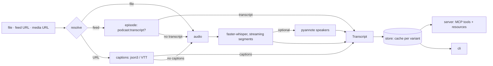

# Architecture

> How a source becomes a cached, paged, cite-ready transcript.

## Overview

## Modules

All under `src/quotable/`. Arrows point from caller to callee; nothing below
`pipeline` imports anything above it.

| Module | Role | Depends on |
|--------|------|------------|
| `models` | Pydantic models (`Transcript`, `Segment`, `Word`, `Chapter`, `MediaInfo`, `TranscriptPage`) and the `QuotableError` family, each with a `fix` | - |
| `config` | `Settings.from_env()`: `QUOTABLE_*` variables, device auto-detect, per-device defaults | - |
| `captions` | Pick a caption track (json3 first, VTT with rolling dedupe second), parse it, read chapters | `models` |
| `audio` | Local file passthrough, yt-dlp `bestaudio` download, source keys and `cite_url` per kind | `models` |
| `feeds` | Sniff a feed, pick an episode, use `<podcast:transcript>`, else the enclosure; http(s) only, redirects checked | `models` |
| `transcribe` | One warm `WhisperModel` per process, CUDA with CPU fallback, segment iterator with `clip_timestamps` resume, inference lock | `config`, `models` |
| `diarize` | Optional pyannote pipeline; speakers assigned to words by overlap, to segments by majority | `transcribe`, `models` |
| `store` | Atomic per-variant cache, `partial.jsonl` for resume, id validation, paging by offset or time window, txt/srt/timestamped renderers | `models` |
| `pipeline` | Orchestration: resolve, captions first, Whisper fallback, locks, cancel, `Outcome(transcript, path, cached)` | everything above |
| `server` | `MCPServer`: three tools, two resources, progress and cancel bridge to the pipeline thread | `pipeline`, `store` |
| `cli` | `quotable get | info | serve` | `pipeline`, `server` |

## Data flow

1. **Resolve** the source outside any lock: a file is hashed, a URL is probed
   with yt-dlp (no download), a feed is loaded and an episode picked. This
   yields the `source_key` and the metadata (title, duration, chapters,
   `cite_url`).
2. **Variant** = `{method}-{language}-{model|captions}[-diarized]`, where
   language is the *requested* one (`und` when none). The cache id handed to
   agents is `source_key:variant`.
3. **Lock** the variant (`filelock` under `OUTPUT_DIR/.locks/`), then check the
   cache. A second caller on the same variant waits and reads the cache.
4. **Captions path** (`mode` `auto` or `captions`, not `diarize`): fetch the
   source's captions or the feed transcript. Empty or unparseable counts as a
   miss, never as a result. A miss in `captions` mode raises `NoCaptionsError`.
5. **Audio path**: download or read the audio, then run Whisper under the
   process-wide inference lock. Each segment goes to `on_segment` (progress),
   is appended to `partial.jsonl`, and the cancel event is checked. A retry
   reads the resume point from `partial.jsonl` and passes VAD-derived clips
   from there.
6. **Diarize** (optional): the pyannote pipeline is fetched before the download
   so a missing extra or token fails fast; speakers are assigned per word.
7. **Finalize** atomically: write `transcript.json`, `.txt`, `.srt` to a temp
   dir and rename it into place. An empty transcript is refused.

## MCP surface

| Name | Annotations | Output |
|------|-------------|--------|
| `media_info` | read-only, idempotent | `MediaInfo` |
| `transcribe` | idempotent, open-world, not destructive | `TranscribeResult` structured content, a text block, a `resource_link` |
| `read_transcript` | read-only, idempotent | `TranscriptPage` |
| `transcript://{id}` | resource, `text/plain` | timestamped rendering |
| `transcript://{id}/meta` | resource, `application/json` | metadata |

Typed failures become `ToolError` with the cause and the fix. The rendered text
opens with a line marking the transcript as third-party content. Progress goes
through `ctx.report_progress(done_s, total_s, newest line)`; a client cancel
sets the pipeline's `threading.Event` and the worker thread stops between
segments.

## Concurrency

- One `filelock` per variant, across processes (CLI and server share a cache).
- One process-wide lock around Whisper inference: two runs on one 8 GB card
  would OOM.
- The server runs each job in a worker thread with `abandon_on_cancel=True`,
  otherwise the handler's cancellation would wait for the job to end before
  the cancel event could be set.

## Boundaries

- stdio isolation belongs to the `mcp` SDK; see
  [notes/mcp-stdio-subprocess.md](../notes/mcp-stdio-subprocess.md).
- No live network in tests. Unit tests fake `YoutubeDL` and HTTP; integration
  tests run the real `tiny` model on a committed public-domain clip.
- Keyframes, OCR and visual analysis are out of scope.

The full decision log, with rationale and rejected options, is promoted here
from the development spec when the feature closes.
